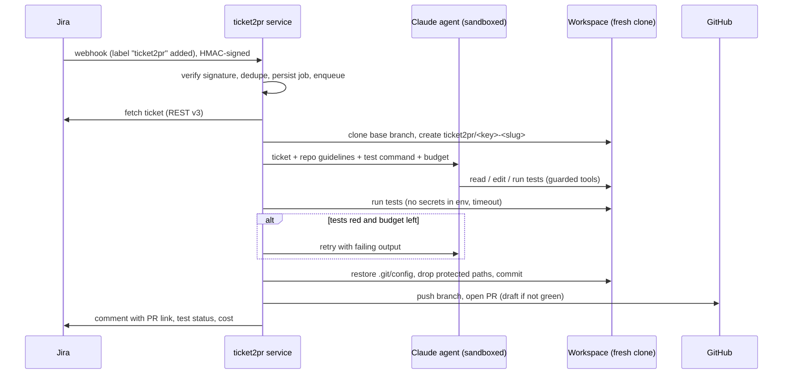

# ticket2pr

**Turn Jira tickets into review-ready GitHub pull requests with a budget-capped, sandboxed Claude agent.**

[](https://github.com/OWNER/ticket2pr/actions/workflows/ci.yml)


[](LICENSE)

Add the `ticket2pr` label to a ticket. A few minutes later the ticket has a comment linking a
pull request that contains the fix, tests that pass, and a line saying exactly what it cost.

```text
PROJ-42 → succeeded
PR: https://github.com/acme/shop/pull/318
Cost $0.84 · 412,903 tokens · 23 turns
```

ticket2pr is a small, auditable harness around the
[Claude Agent SDK](https://code.claude.com/docs/en/agent-sdk). The model writes the code;
ticket2pr decides what it may touch, how much it may spend, whether the result is
trustworthy, and what reviewers see.

## Why it is different from "an LLM in a loop"

| Concern | What ticket2pr does |
|---|---|
| **Cost** | Hard per-ticket budget (`max_budget_usd`) enforced by the SDK and shared across retries; tokens and dollars are reported on the PR, on the ticket and in the job history. |
| **Correctness** | Runs the repository's tests after the agent; a failing run gets one retry with the failure output; still red means a **draft** PR, never a green one. |
| **Isolation** | Fresh clone per job, Bash in an OS sandbox with a network allowlist, a `PreToolUse` guard (paths, `git push`, env dumps), no repository settings or hooks loaded, secrets blanked from the agent's environment. |
| **Supply chain** | The harness, not the agent, commits and pushes, with hooks disabled, `.git/config` restored from a snapshot and credentials passed outside argv and `.git/config`. Protected paths (CI, `.env`, keys) are never committed. |
| **Measurability** | A SWE-bench-style eval suite with hidden tests reports resolve rate and **cost per resolved ticket**. |

## How it works



Code map (`src/ticket2pr/`):

| Module | Responsibility |
|---|---|
| `pipeline.py` | The orchestration above; maps every failure to a recorded job status |
| `agent/` | `CodingAgent` protocol, Claude Agent SDK runner, prompts, tool-call guard |
| `trackers/` | `Tracker` protocol; Jira Cloud (with ADF conversion) and local YAML files |
| `scm/` | Hardened async git wrapper, GitHub REST client, `RepoHost` (GitHub or local) |
| `verify.py` | Test-command detection and isolated test runs |
| `server.py` / `worker.py` | FastAPI webhook + jobs API, asyncio worker pool |
| `store.py` | SQLite job history with atomic, idempotent claims |
| `evals.py` | Offline eval harness (oracle and Claude agents) |

More detail: [architecture](docs/architecture.md) · [security model](docs/security.md) ·
[configuration](docs/configuration.md) · [evals](docs/evals.md).

## Quick start

Requirements: Python 3.12+, [uv](https://docs.astral.sh/uv/), git, an Anthropic API key.

```bash
git clone https://github.com/OWNER/ticket2pr && cd ticket2pr
make install            # uv sync + pre-commit hooks
make eval               # offline suite with the oracle agent: free, no credentials
```

### Try it on a local repository, no Jira or GitHub needed

```bash
export ANTHROPIC_API_KEY=sk-ant-...
uv run ticket2pr eval --agent claude --task paginate      # real agent, ~$1
```

or point `run` at your own directories (`<repos>/<owner>/<name>` git repos, `<tickets>/<KEY>.yaml`):

```bash
uv run ticket2pr run SHOP-101 --repo acme/shop --tickets-dir ./tickets --repos-dir ./repos
```

### Run the service

```bash
cp .env.example .env    # Jira, GitHub, Anthropic credentials + project → repo mapping
uv run ticket2pr doctor # checks the configuration
uv run ticket2pr serve  # or: docker compose up --build
```

In Jira (*Settings → System → Webhooks*), create a webhook for *Issue created* and *Issue
updated*, pointing to `https://<host>/webhooks/jira`, with the same secret as
`T2P_JIRA_WEBHOOK_SECRET`. Then add the `ticket2pr` label to a ticket.

```bash
ticket2pr jobs                     # recent jobs with cost and PR links
curl -H "Authorization: Bearer $T2P_API_TOKEN" localhost:8080/jobs
```

## Evaluation

`ticket2pr eval` runs each task in [`evals/tasks`](evals/tasks) through the real pipeline,
then grades the pushed branch with **hidden tests** the agent never saw:

```text
Task      Ticket    Status     Resolved  Cost   Tokens   Turns
envflags  OPS-7     succeeded  yes       $…     …        …
paginate  SHOP-101  succeeded  yes       $…     …        …
retry     NET-33    succeeded  yes       $…     …        …
slugify   BLOG-12   succeeded  yes       $…     …        …
Resolved 100% of 4 task(s) · total $… · per resolved ticket $…
```

The oracle agent (reference solutions) runs in CI on every commit, so the dataset and the
grader stay correct. Run `--agent claude` to measure the model; see [docs/evals.md](docs/evals.md).

## Development

```bash
make check   # ruff format + lint, mypy --strict, pytest with a 90% coverage gate
```

The test suite runs fully offline: a scripted agent, a local git "host" and YAML tickets
exercise the real pipeline end to end, including attacks such as `.git/config` rewrites and
`pre-push` hooks planted by the agent. See [CONTRIBUTING.md](CONTRIBUTING.md).

## Limitations

- One repository per Jira project; the agent sees a single repo.
- The test command is detected from common layouts (pytest, npm, go, cargo, make) or set
  with `T2P_TEST_COMMAND`; repos without tests get draft PRs.
- The in-process queue suits a single replica. Several replicas need a shared queue (the
  `JobQueue.submit` seam) and a shared database.

## License

[MIT](LICENSE) © Chawki JABALLI
