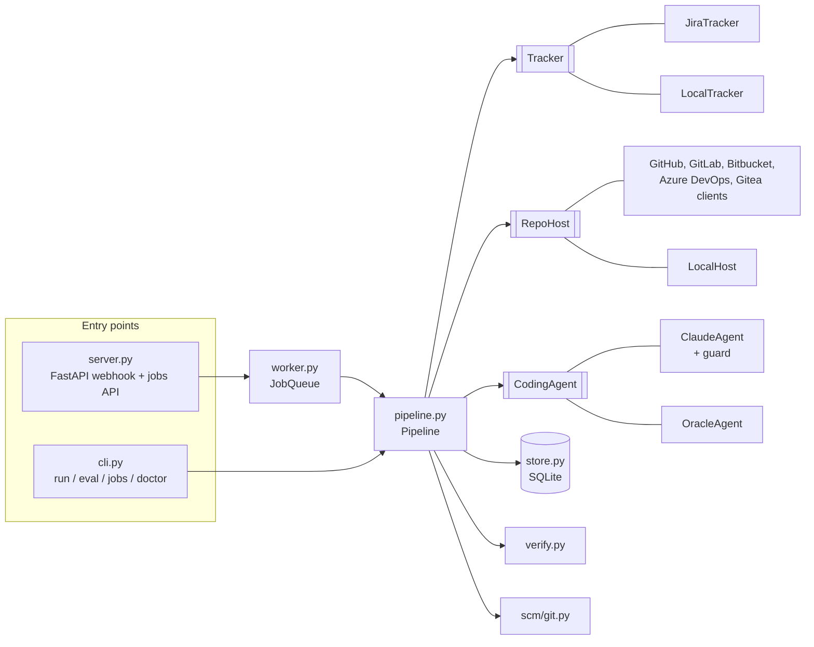

# Architecture

## Design principles

1. **The harness owns side effects.** The agent edits files and runs commands in a scratch
   clone. Everything that leaves the machine (commits, pushes, PRs, comments) is done by
   deterministic code after the agent has stopped.
2. **Ports and adapters.** The pipeline talks to the outside world through three protocols,
   `Tracker`, `RepoHost` and `CodingAgent`, never through Jira, a forge or the SDK directly
   (git, the test runner and the SQLite `JobStore` are concrete). Production adapters and
   offline adapters (`LocalTracker`, `LocalHost`, scripted agents) are interchangeable, which
   is what makes the end-to-end tests and the eval suite possible.
3. **Failures are data.** Every expected failure is a `Ticket2PRError` subclass. The pipeline
   turns it into a terminal job status with a human-readable reason, reports it on the ticket (only its kind when the text comes from git, an API or the OS)
   and keeps the spend. Unexpected exceptions are caught at the same boundary, logged with a
   traceback, and never kill a worker.
4. **Typed and small.** `mypy --strict`, frozen Pydantic models for domain data, no global
   state; configuration is a single `Settings` object injected at the composition root
   (`runtime.py`).

## Components



## Job lifecycle

```text
queued ──► running ──► succeeded      PR opened, tests green
                   ├─► needs_review   PR opened but not verified: tests red or none found
                   │                  (a draft unless drafts are disabled or unavailable)
                   ├─► failed         no PR: agent error/budget, no diff, policy violation, …
                   └─► skipped        ticket lacks the trigger label
```

`JobStore.claim` creates the `queued` row inside a `BEGIN IMMEDIATE` transaction and refuses
when the ticket already has a queued or running job, so duplicate webhooks are harmless.
On startup, the service re-enqueues `queued` jobs and marks the ones a crash left `running`
as `failed`. A graceful stop cancels in-flight runs, which record themselves as failed
("interrupted") so their tickets can be processed again.

## Budget and retries

The pipeline makes at most two agent runs (`RunOptions.max_attempts`, not a setting). Each run receives
`max_budget_usd − spent_so_far` as its SDK budget, and a retry is skipped when less than
$0.25 remains. A retry only happens when the agent finished normally but the tests failed;
the failing output (tail) is passed back as feedback.

## Extending

- **Another tracker** (Linear, GitHub Issues): implement `Tracker` (`get_ticket`, `comment`,
  `aclose`) and wire it in `runtime.build_runtime`.
- **Another forge**: subclass `scm.forge.ForgeClient` (an authenticated JSON API) and
  implement `clone_url`, `open_or_update_pr` and, if the token is not a Basic password,
  `git_auth`; add it to `runtime._FORGES` and `config.ScmProvider`. In fork mode the pipeline
  pushes to `<fork_owner>/<name>` and passes it as `source_repo`.
- **Another agent**: implement `CodingAgent.run(task) -> AgentResult`. The pipeline's
  guardrails (git hygiene, protected paths, tests, budget accounting) apply unchanged.
- **A distributed queue**: replace `JobQueue`'s `submit`/`enqueue`/`start`/`stop` (restart
  recovery calls `enqueue` directly) with Arq/RQ/Celery and run
  `Pipeline.run` in the consumer; `JobStore` would move to Postgres.
